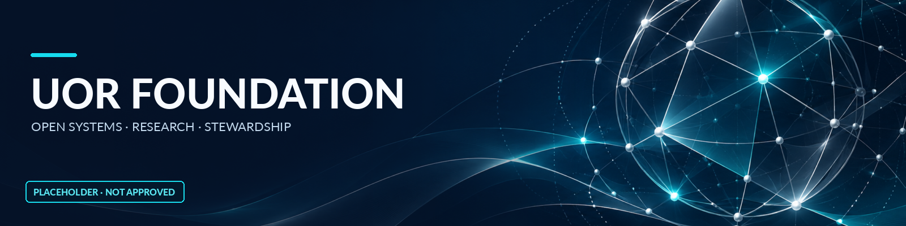

*Illustrative placeholder pending brand review.*

# UOR Foundry

**A modeled organizational platform, distinct from the separate portal publication repository.** The model and requirements exist, but the functional platform is not accepted as complete.

[Current status](#status) · [Product contract](SPEC.md) · [Implementation gaps](IMPLEMENTATION.md) · [Application evidence](APPLICATION-VERIFICATION.md) · [Portal publisher](https://github.com/UOR-Foundation/foundry-web) · [Repository policy](AGENTS.md)

 

Foundry is a generic organization-management platform modeled with PrismPM.
Organizations and their physical sites are created through normal workflows;
no account, organization or administrator mailbox is pre-seeded. UOR Foundation
is one such organization, with its Citizen Gardens operating model and Foundry
sites, not a privileged platform identity.

This repository owns the platform's services, organization lifecycle, workflows,
scoped authority and portal Views. PrismPM and prism-stdlib generate and validate
its artifacts against adopted standards. The required contract is [SPEC.md](SPEC.md).

[foundry-web](https://github.com/UOR-Foundation/foundry-web) publishes the exact
verified and authorized portal release, then verifies its live deployment.
It does not maintain another implementation of the platform or its services.
Generic SDK capabilities belong upstream.

## Status

Neither the functional core nor the full platform is accepted. The current
`src/Foundry.lex.tex` entry points echo their inputs; imported model declarations
and prototype tests do not implement the required application journeys.
[IMPLEMENTATION.md](IMPLEMENTATION.md) records the audited corrections.

The authorized first release requires real identity, roles, shared workspaces,
persistence and messaging, including verified email enrollment/recovery and
ordinary organization creation. Every other service and control in
[SPEC.md](SPEC.md) remains required. Publication must wait for complete generated
artifacts, independent acceptance evidence and authorized producer handoff.

PrismPM is consumed as an SDK, following
[Calculator](https://github.com/UOR-Foundation/calculator-example).

The SDK/template binding selects an authenticated development candidate.
Reviewed development infrastructure belongs on `main` after the complete
repository gate passes. Main-branch integration does not qualify the SDK or
portal for production release; publication retains its separate acceptance
requirements. Source checkouts and host tools are not substitutes for the
locked SDK.

This branch preserves the application work and complete acceptance gates of
[PR #3](https://github.com/UOR-Foundation/uor-foundry/pull/3), without narrowing
the product requirements in [SPEC.md](SPEC.md). Passing development
infrastructure checks is not application or production acceptance.

Repository policy is in [AGENTS.md](AGENTS.md) and
[TEMPLATE-CONTRACT.md](TEMPLATE-CONTRACT.md).
